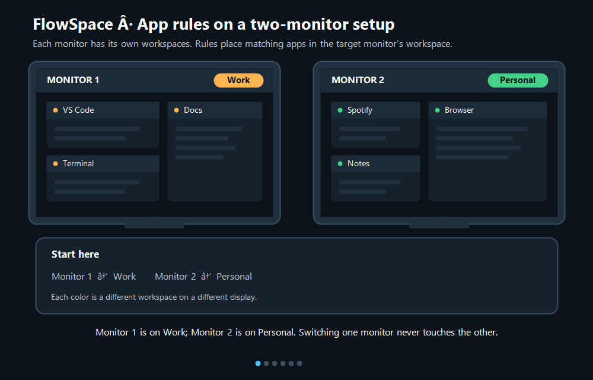

# FlowSpace

**FlowSpace — Independent virtual desktops for each monitor on Windows.**



## Download for Windows

[**Download the latest FlowSpace release**](https://github.com/Anurag123Chauhan/FlowSpace/releases/latest) — choose the recommended installer or the portable ZIP. No compiler or source code needed.

## Why FlowSpace?

- **Keep each screen focused.** Give work, personal tasks, and projects their own space without changing what’s open on another monitor.
- **Switch without closing windows.** If FlowSpace exits unexpectedly, its journal can reveal windows that are still open when you restart the app.
- **Make each workspace yours.** Name and color workspaces, set per-monitor wallpapers, and use hotkeys to move between them.

## FlowSpace vs. Windows virtual desktops

Windows virtual desktops switch your desktop across the display setup. FlowSpace gives each monitor its own independent workspace set: switch the screen under your mouse while the others stay as they are. FlowSpace manages windows on the current Windows desktop; it does not change how Task View works.

| | Windows virtual desktops | FlowSpace |
|---|---|---|
| Switch workspaces independently per monitor | No | **Yes** |
| Keep windows grouped in separate workspaces | Yes | **Yes** |
| Assign workspace wallpapers independently per monitor | Not per-monitor | **Yes** |

## Installation

1. Download the **Installer** (`FlowSpace-<version>-windows-x64-setup.exe`) or **ZIP** (`FlowSpace-<version>-windows-x64.zip`) from the [latest release](https://github.com/Anurag123Chauhan/FlowSpace/releases/latest).
2. Run the installer, or extract the ZIP and launch `flowspace.exe`.
3. FlowSpace starts in the system tray. Use the hotkeys below or right-click its tray icon.

Requires Windows 10 (1903+) or Windows 11, x64. Administrator rights are not required. Configuration and logs are stored in `%LOCALAPPDATA%\FlowSpace\`.

To uninstall, exit FlowSpace from the tray, then use **Installed apps** in Windows Settings or **Uninstall FlowSpace** in the Start Menu. See [UNINSTALL.md](UNINSTALL.md).

## Features

- **Independent per-monitor workspaces** — each monitor has its own workspace list and active selection.
- **Window hide/show with crash recovery** — FlowSpace logs windows before hiding them so it can reveal still-open windows on its next start.
- **Per-workspace wallpapers** — assign wallpapers per monitor; original wallpapers can be restored on exit.
- **Workspaces you can shape** — create, rename, recolor, reorder, duplicate, and delete workspaces.
- **Global hotkeys** with conflict detection, plus a workspace switcher popup and tray controls.
- **App Rules** — send matching new windows to a chosen workspace.
- **Portable or installed** — no admin rights, account, or background service required.

### Hotkeys

| Hotkey | Action |
|---|---|
| `Ctrl+Alt+Left` / `Ctrl+Alt+Right` | Switch workspace on the monitor under your mouse |
| `Ctrl+Alt+1` … `Ctrl+Alt+9` | Jump to workspace 1–9 |
| `Ctrl+Alt+Shift+Left` / `Ctrl+Alt+Shift+Right` | Move the active window to the previous/next workspace |
| `Ctrl+Alt+Space` | Open the workspace switcher |
| `Ctrl+Alt+F12` | Reveal all hidden windows |
| `Ctrl+Alt+O` | Open Settings |

Left-click the tray icon to open Settings. Right-click it for per-monitor switching, pause, reveal all, and exit.

## FAQ

### Do I need to replace Windows virtual desktops?

No. Use FlowSpace workspaces within the current Windows desktop. Windows keeps control of Task View and any windows it hides on other native desktops.

### Does switching close my apps?

No. FlowSpace hides windows assigned to other workspaces and shows the selected workspace’s windows. They remain open.

### What happens if FlowSpace or Windows crashes?

FlowSpace can reveal still-open windows when restarted after an app crash. It can’t reopen apps or restore unsaved work after a Windows reboot.

### Can I use it without installing?

Yes. Download the portable ZIP, extract it, and run `flowspace.exe`.

### How do I remove my settings too?

Uninstalling leaves personal configuration and logs in place. To remove them, delete `%LOCALAPPDATA%\FlowSpace\` after exiting FlowSpace. See [UNINSTALL.md](UNINSTALL.md).

## Troubleshooting

- **A hotkey does nothing:** another app may already use that shortcut. Open Settings with `Ctrl+Alt+O` or the tray icon, then review **Shortcuts** for conflicts and choose a different binding.
- **A window is hidden and you need it now:** press `Ctrl+Alt+F12` or choose **Reveal All** from the tray menu.
- **A workspace or wallpaper is unexpected:** open Settings and check the selected monitor’s workspace list and wallpaper assignment.
- **FlowSpace is already running:** the app is single-instance; open it from the system tray instead of starting a second copy.
- **Still stuck?** Open an [issue](https://github.com/Anurag123Chauhan/FlowSpace/issues) and include what you expected, what happened, and relevant log details from `%LOCALAPPDATA%\FlowSpace\logs\flowspace.log`. Remove personal information before sharing logs.

## Contributing

Contributions and bug reports are welcome. For code changes, build with the project’s MinGW-w64 UCRT64, CMake, and Ninja toolchain; run `build\cmake\flowspace_tests.exe` or `ctest --test-dir build\cmake`; then open a pull request with a concise description and test results. See [AGENTS.md](AGENTS.md) for build instructions and [docs/engineering/TESTING.md](docs/engineering/TESTING.md) for the manual test checklist.

## App Rules

App Rules in Settings automatically send matching **new** windows to a target workspace:

1. Focus a window of the app you want to assign.
2. Open Settings (`Ctrl+Alt+O`) and select **App Rules**.
3. Click **+ Add rule**. FlowSpace captures the app’s `.exe` name and the workspace active on its monitor.

Rules can be enabled, disabled, or deleted in Settings. They affect new windows; adding a rule does not move windows that are already open.

For advanced matching by executable path or window-title substring, exit FlowSpace first, then edit the `appRules` array in `%LOCALAPPDATA%\FlowSpace\config.json`:

```jsonc
"appRules": [
  {
    "id": "rule-1",
    "enabled": true,
    "exeName": "notepad.exe",       // exact file name, case-insensitive
    "exePath": "",                  // optional full path, case-insensitive
    "titleContains": "Draft",       // optional title substring, case-sensitive
    "targetWorkspaceId": "ws-1",    // workspace id from the "workspaces" array
    "monitorPreference": 0,         // 0 = any, 1 = follow workspace, 2 = specific monitor
    "monitorStableId": "",          // used only when monitorPreference is 2
    "launchCommand": ""             // reserved; currently unused
  }
]
```

Rules are checked in order; the first enabled match wins. At least one of `exeName`, `exePath`, or `titleContains` must be set. Prefer **+ Add rule** when targeting a specific monitor, as it captures the long display identifier.



## Social preview

The GitHub social preview artwork is [`docs/assets/social-preview.png`](docs/assets/social-preview.png). To use it on shared repository links, upload it under **Repository Settings → General → Social preview**.

## License and project docs

FlowSpace is distributed under the MIT License; see [`LICENSE`](LICENSE). Third-party components retain their own licenses, listed in [`THIRD-PARTY-NOTICES.txt`](THIRD-PARTY-NOTICES.txt).

| Reference | Purpose |
|---|---|
| [`PRODUCT.md`](docs/PRODUCT.md) | Product facts, supported platforms, and limitations |
| [`ARCHITECTURE.md`](docs/engineering/ARCHITECTURE.md) | Modules, Windows APIs, and data flow |
| [`CONFIGURATION.md`](docs/engineering/CONFIGURATION.md) | `config.json` schema |
| [`CODE_QUALITY.md`](docs/engineering/CODE_QUALITY.md) | C++ conventions |
| [`TESTING.md`](docs/engineering/TESTING.md) | Manual integration test checklist |
| [`AGENTS.md`](AGENTS.md) | Build instructions and coding-agent workflow |

To build the project website locally, run `node website/build.mjs`. The static output is in `build/site/`.
